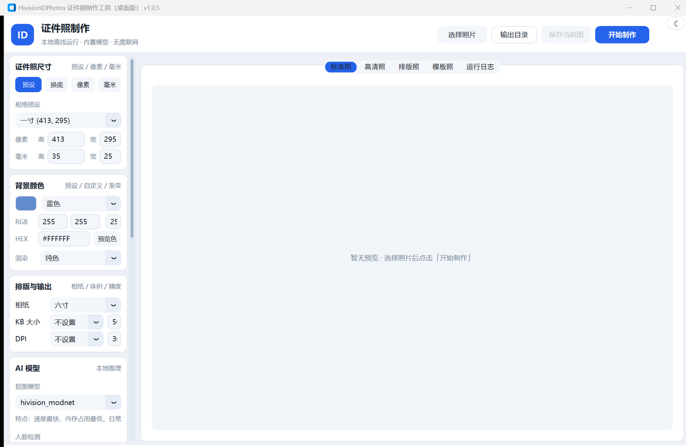
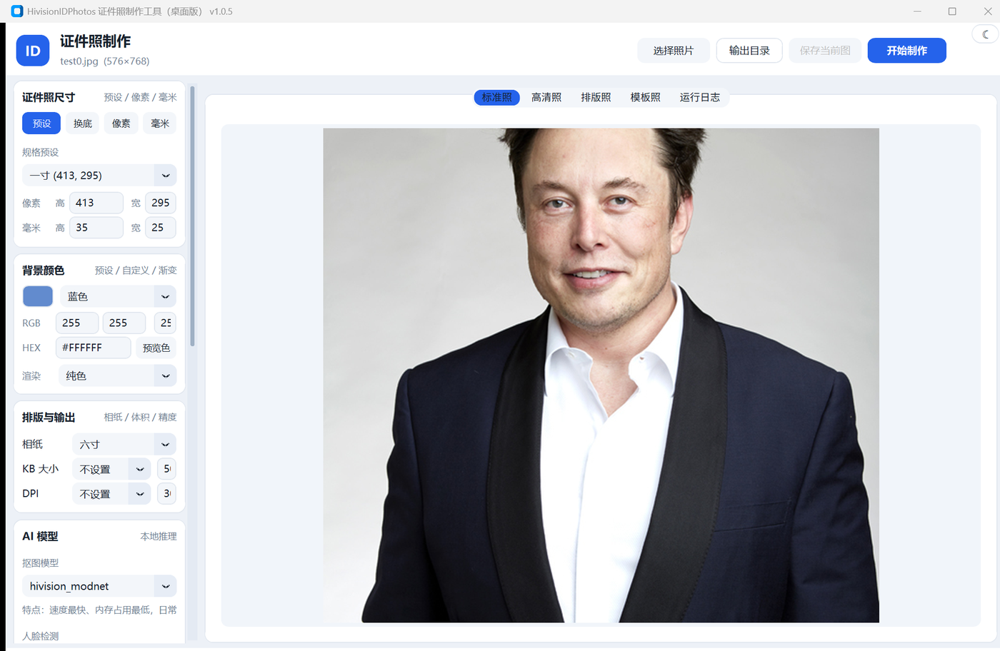
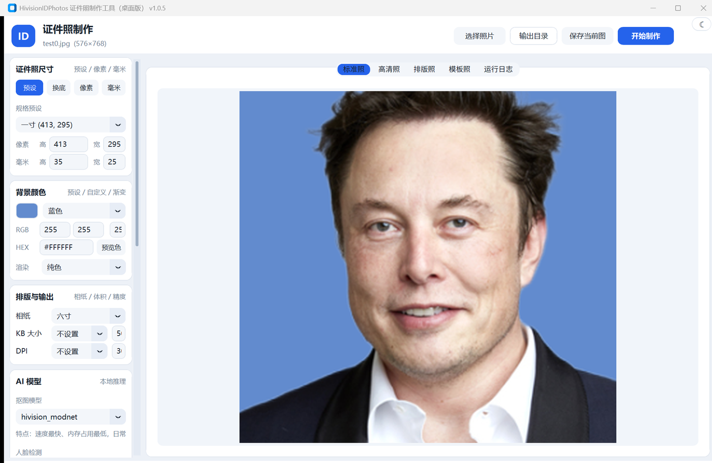
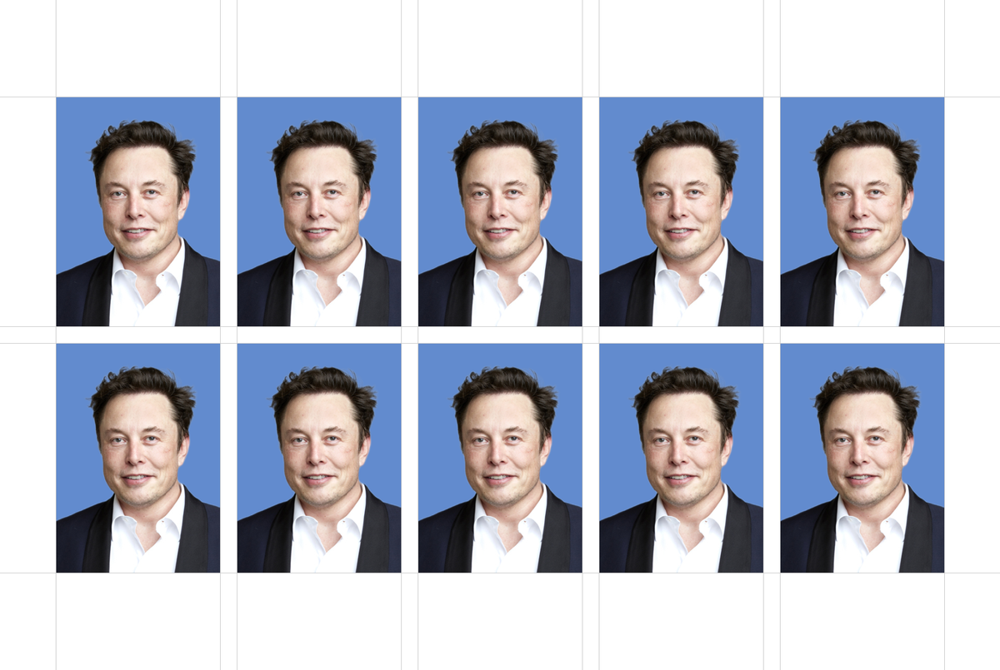
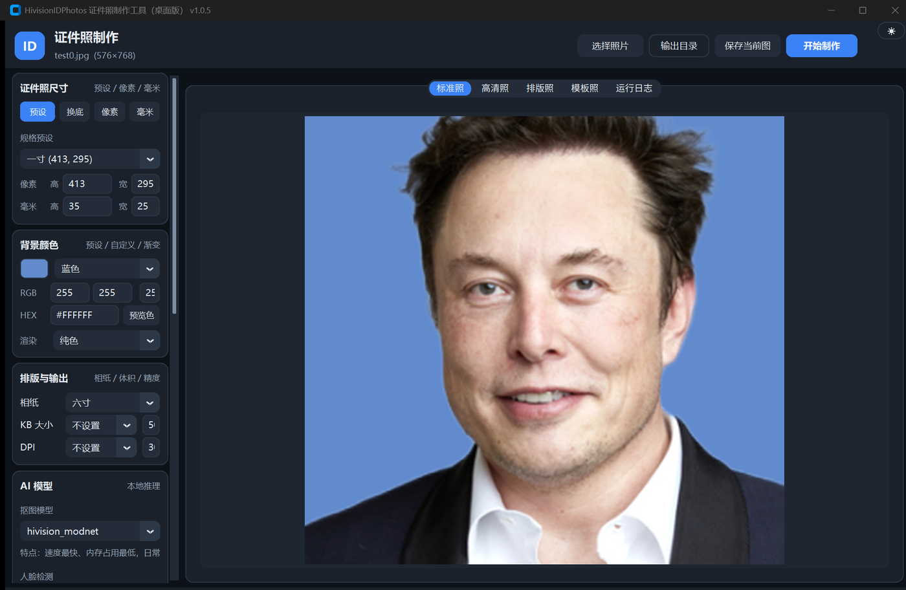
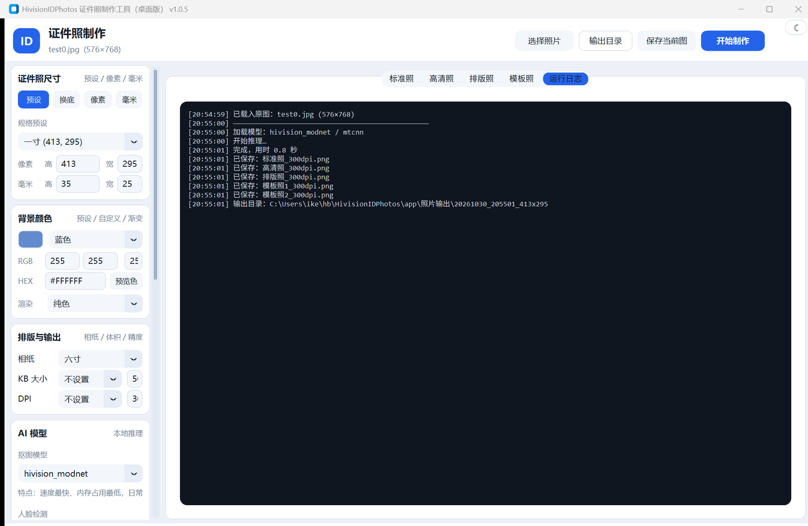

# HivisionIDPhotos Desktop

把 [HivisionIDPhotos](https://github.com/Zeyi-Lin/HivisionIDPhotos) 的证件照制作能力，做成一个 **Windows 原生桌面程序**（Tk + CustomTkinter）：不装浏览器、不起 Gradio 服务，双击就能出片。所有推理都在本机完成，照片不上传。



> 本项目是面向 Windows 的**独立桌面封装发行版**，不是上游仓库的 fork。
> 上游代码以 Apache-2.0 许可使用，版权归原作者 Zeyi-Lin 及贡献者所有；本项目新增桌面 UI 层、打包工程与模型包机制。

## 两个发行包，按需下一个

同一个版本同时提供「带模型」与「不带模型」两种包，外加可单独分发的模型包：

| 发行包 | 解压体积 | 下载体积 | 内含权重 | 适合谁 |
| --- | --- | --- | --- | --- |
| **完整包** `HivisionIDPhotos-v1.1.2-full.zip` | 774MB | 565MB | 5 个 onnx 全部内置 | 无网络、不想等下载、拷给别人直接用 |
| **精简包** `HivisionIDPhotos-v1.1.2-slim.zip` | 239MB | 107MB | 不含，首次按需下载 / 导入模型包 | 网络可用，想省磁盘与下载时间 |
| **模型包** `hivision-models-v1.1.2.zip` | — | 458MB | 5 个 onnx，独立分发 | 给精简包补模型，或只更新模型不换程序 |

两个发行包**代码完全一致**，差别只有 `_internal\hivision\creator\**\weights\*.onnx` 是否存在。
MTCNN 人脸检测用的 `onet / pnet / rnet.onnx`（合计几 MB，由 `mtcnn-runtime` 自带的必需件）两个包都有，不单列。

获取方式：仓库 [Releases](https://github.com/kitblue/HivisionIDPhotos-Desktop/releases)（或 Gitea 同名仓库的 Release），解压即用，无需安装。

### 解压到哪里都行（长路径适配）

Windows 单条路径上限 260 字符，`_internal\onnxruntime\capi\onnxruntime_pybind11_state.pyd` 路径一旦超限，
系统加载器直接报 `文件名或扩展名太长`，而且崩在 PyInstaller 引导阶段（`python311.dll` 都没加载完），
Python 代码来不及做任何补救。所以发行包把 exe 拆成了两层：

| 文件 | 作用 |
| --- | --- |
| `HivisionIDPhotos.exe` | 6KB C# 启动器。用 `GetShortPathNameW` 把程序目录转成 8.3 短路径，再用短路径拉起主程序 |
| `HivisionIDPhotos.real.exe` | 真正的主程序（PyInstaller 产物），不要直接双击，也不要删 |

启动器会把用户实际解压的长路径通过 `HV_ORIG_HOME` 传给主程序，界面状态栏与日志仍显示真实路径；
短名不可用（磁盘关闭 8.3 支持）时自动降级为原路径启动，启动失败弹出提示引导换短路径。
另有运行期 hook `app/pyi_rth_shortpath.py` 作为第二道防线（`sys._MEIPASS` 短名化 / 复制到 `%TEMP%\hidp_ort`）。

实测：程序放在 291 字符深目录（pyd 全路径 278 字符）时，自检输出 5 张照片正常、GUI 正常运行。

## 三步出片

<table>
<tr>
<td width="50%"></td>
<td width="50%"></td>
</tr>
<tr>
<td><b>1. 选照片、调参数</b><br>左侧一栏搞定尺寸、底色、排版、美颜、水印；右侧实时预览原图，参数改动即时反映。</td>
<td><b>2. 一键制作</b><br>点「开始制作」，本地推理自动完成抠图、换底、裁剪、排版，标准照 / 高清照 / 排版照分页签预览。</td>
</tr>
</table>

图片缩放会跟随窗口自适应：标准照按原比例缩放，高清照、排版照、模板照占满可用空间，换尺寸不用重新出图。

## 功能一览

| 模块 | 能力 |
| --- | --- |
| 尺寸 | 尺寸列表 / 只换底 / 自定义 px / 自定义 mm |
| 背景 | 预设色 + 自定义 RGB / HEX + 美式背景 |
| 渲染 | 纯色 / 上下渐变 / 中心渐变 |
| 排版 | 六寸 / 五寸 / A4 / 3R / 4R，可加裁剪线、JPEG 输出、自定义 KB 与 DPI |
| 模型 | 4 种抠图模型 + 2 种人脸检测可切换，选择时下方实时提示模型特点；卡片底部显示本地模型「已就绪 / 缺几个」，可导入离线模型包 |
| 调整 | 美颜（美白 / 亮度 / 对比度 / 饱和度 / 锐化）、头身比、头顶留白、人脸旋转对齐、水平翻转 |
| 其他 | 文字水印（颜色 / 字号 / 透明度 / 角度 / 间距）、2 款模板照、多脸照片自动聚焦最大人脸 |

## 输出示例

<table>
<tr>
<td align="center"><br><sub>标准照 295×413</sub></td>
<td align="center"><br><sub>高清照 600×844</sub></td>
<td align="center"><br><sub>六寸排版照（含裁剪线）</sub></td>
</tr>
</table>

一次制作同时产出五张图（标准照、高清照、排版照、模板照 ×2），文件名带日期与尺寸前缀，默认落在程序目录的 `照片输出/` 下；目录不可写时自动回退到「图片」文件夹。

## 界面与日志

<table>
<tr>
<td width="50%"></td>
<td width="50%"></td>
</tr>
<tr>
<td>右上角 ☾ / ☀ 一键切换浅色 / 深色皮肤，配色与滚动条同步换装。</td>
<td>每个步骤的耗时、模型加载、输出路径都写在日志页签里，出问题一眼定位。</td>
</tr>
</table>

## 模型：三种获取方式

源码仓库**永远不含 onnx 权重**（`.gitignore` 排除，避免仓库膨胀与许可混乱），权重只以两种形态流通：内置进「完整包」，或单独打成的「模型包」。

| 方式 | 操作 | 适用 |
| --- | --- | --- |
| ① 内置 | 直接下**完整包**，权重已在 `_internal\hivision\creator\*\weights` | 想开箱即用、无网环境 |
| ② 在线下载 | 精简包首次用到某模型时提示下载；或点「AI 模型」卡片里的 **下载 / 补齐模型** | 网络良好，按需只拿要用的 |
| ③ 导入模型包 | 点卡片里的 **导入模型包（.zip）…** 选模型包；或把 zip 放进程序目录 `models\`，下次启动自动导入 | 内网机器、批量部署 |

| 模型 | 用途 | 大小 | 来源 |
| --- | --- | --- | --- |
| hivision_modnet | 抠图（默认，最快） | 24.7MB | 上游 Release `pretrained-model` |
| modnet_photographic_portrait_matting | 抠图（发丝更细） | 24.7MB | 上游 Release `pretrained-model` |
| rmbg-1.4 | 抠图（半透明边缘更强） | 168MB | HuggingFace `briaai/RMBG-1.4`（非商用） |
| birefnet-v1-lite | 抠图（质量最高、最慢） | 213.6MB | `ZhengPeng7/BiRefNet` Release v1 |
| retinaface-resnet50 | 人脸检测（小脸 / 侧脸） | 104.4MB | 上游 Release `pretrained-model` |

* MTCNN 人脸检测由 `mtcnn-runtime` 包自带，无需单独下载。
* 权重落盘位置：`app/hivision/creator/weights/`（RetinaFace 在 `app/hivision/creator/retinaface/weights/`），已被 `.gitignore` 排除。
* 界面「AI 模型」卡片内有 **下载 / 补齐模型** 按钮，缺什么补什么。

### 模型包（离线分发用）

模型包是一个固定结构的 zip，解压后与程序资源目录一一对应，安装即复制：

```
hivision-models-v1.1.2.zip
├─ manifest.json                    # 版本、每个模型的大小与 sha256、来源 URL
└─ hivision/creator/…
   ├─ weights/{hivision_modnet,modnet_photographic_portrait_matting,rmbg-1.4,birefnet-v1-lite}.onnx
   └─ retinaface/weights/retinaface-resnet50.onnx
```

生成与校验：

```bat
python scripts\pack_models.py                          :: 用本地已下载的权重组包，输出 output\hivision-models-v<ver>.zip
python scripts\pack_models.py --model rmbg-1.4 --verify :: 只打指定模型并校验 sha256
python scripts\pack_models.py --out D:\hivision-models-v1.1.2.zip
```

安装方式三选一，校验失败会在日志里报出具体文件，不会写坏已有权重：

* 界面「导入模型包（.zip）…」，装完自动刷新模型状态；
* 把 zip 放到 `HivisionIDPhotos.exe` 同级 `models\` 目录，启动时自动导入；
* 已有散装 onnx（例如从完整包拷出来），用「从文件夹导入权重…」或环境变量 `HV_MODELS_DIR` 指目录，按文件名对号入座。
* 导入是**增量**的：已存在且大小一致的模型直接跳过，重复导入不会重复占用磁盘。

### 命令行预下载

```bat
python scripts\download_models.py                 :: 只下默认必需（hivision_modnet）
python scripts\download_models.py --all           :: 全部 5 个（约 535MB）
python scripts\download_models.py --model rmbg-1.4 birefnet-v1-lite
python scripts\download_models.py --list
```

国内网络可先设置镜像前缀（可选，仅拼接在官方 URL 前，官方源仍作兜底）：

```bat
set HV_MODEL_MIRROR=https://ghfast.top/
```

## 运行

源码运行需要 Python 3.10+ 及上游依赖：

```bat
pip install -r app\requirements.txt -r app\requirements-app.txt
python app\desktop_app.py
```

或直接双击根目录 `启动.bat`（使用项目内置 `runtime\python.exe`，需自行准备运行时）。

## 目录结构

```
HivisionIDPhotos-Desktop/
├─ app/
│  ├─ desktop_app.py          # 桌面版主程序（UI + 引擎封装）
│  ├─ model_manager.py        # 模型清单、在线下载、完整性校验
│  ├─ model_bundle.py         # 模型包：生成 / 校验 / 安装 / 启动自动导入
│  ├─ demo/                   # 上游演示与文案（复用其尺寸、配色数据）
│  └─ hivision/               # 上游算法核心（抠图、人脸检测、排版、水印）
├─ scripts/
│  ├─ download_models.py      # 命令行模型下载
│  ├─ pack_models.py          # 打模型包（hivision-models-vX.zip）
│  ├─ build_packages.py       # 一键出 full / slim 两个发行包（含 zip）
│  └─ gen_changelog.py        # 按提交记录自动生成 CHANGELOG.md
├─ docs/images/               # 本文档所用界面与输出示例图
├─ CHANGELOG.md               # 自动生成的更新日志
├─ scripts/launcher/            # 长路径启动器源码 Launcher.cs + 编译好的 Launcher.exe
├─ 启动.bat / 启动-调试.bat
└─ 使用说明.txt
```

## 打包（PyInstaller）

一条命令出两个包，代码同一份，只在最后决定要不要删权重：

```bat
python scripts\build_packages.py                      :: full + slim 都出
python scripts\build_packages.py --variant slim       :: 只出精简包
python scripts\build_packages.py --variant full --keep-dir --no-zip
```

脚本做的事：`PyInstaller --onedir`（窗口模式、`--add-data` 拷 hivision / assets / demo、`--collect-all mtcnnruntime`）→ 构建完对 slim 包剥离 `_internal` 下的 5 个 onnx → 写各自的使用说明 → 压缩成 zip，输出到 `output/`：

```
output/HivisionIDPhotos-v1.1.2-full/  … 774MB + 同名 .zip 565MB
output/HivisionIDPhotos-v1.1.2-slim/  … 239MB + 同名 .zip 107MB
```

发版顺序建议：

```bat
python scripts\pack_models.py --verify                       :: 1. 打模型包（可选，给精简包用户补模型）
python scripts\build_packages.py                             :: 2. 出两个发行包
python scripts\gen_changelog.py --version 1.1.0              :: 3. 依 GitHub 提交自动生成 CHANGELOG.md
```

`gen_changelog.py` 读取仓库 tag 与提交（Conventional Commits 归类为新增功能 / 问题修复 / 文档 / 构建等小节），可 `--dry-run` 先看效果；凭据取自 `GITHUB_TOKEN` 或 Windows 凭据管理器。

## 许可

* 本项目新增代码：Apache-2.0
* 上游 HivisionIDPhotos：Apache-2.0（见 `app/LICENSE`）
* RMBG-1.4 权重为 **非商用** 许可，商用请改用其他抠图模型
* BiRefNet 权重遵循其原仓库许可（MIT）

## 致谢

[Zeyi-Lin/HivisionIDPhotos](https://github.com/Zeyi-Lin/HivisionIDPhotos)、[ZHKKKe/MODNet](https://github.com/ZHKKKe/MODNet)、[briaai/RMBG-1.4](https://huggingface.co/briaai/RMBG-1.4)、[ZhengPeng7/BiRefNet](https://github.com/ZhengPeng7/BiRefNet)。
*（内容由AI生成，仅供参考）*
